# BizzNex

[](https://github.com/cheruvathoorshajd/BizzNex/actions/workflows/ci.yml)


**A business workspace for small teams.** Projects and tasks, a CRM with a deal pipeline,
marketing tools and a built-in assistant, in one calm interface. Full-stack TypeScript:
React + NestJS + PostgreSQL, with one shared Zod contract between them.

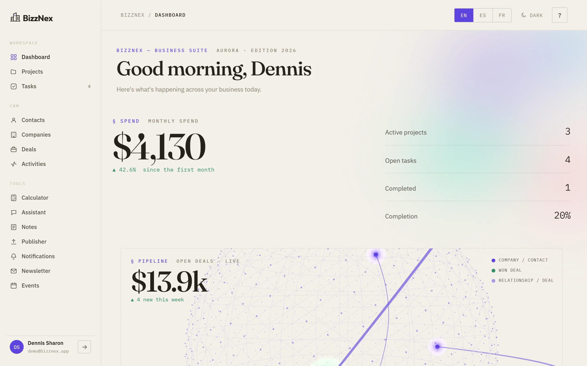

**Try it:** run it locally ([§ 8](#8--running-it)) and click **Explore the demo** on the
landing page, or sign in as `demo@bizznex.app` / `password`. The demo workspace resets
itself every 30 minutes. *(A hosted demo isn't deployed yet.)*

| | |
|---|---|
| 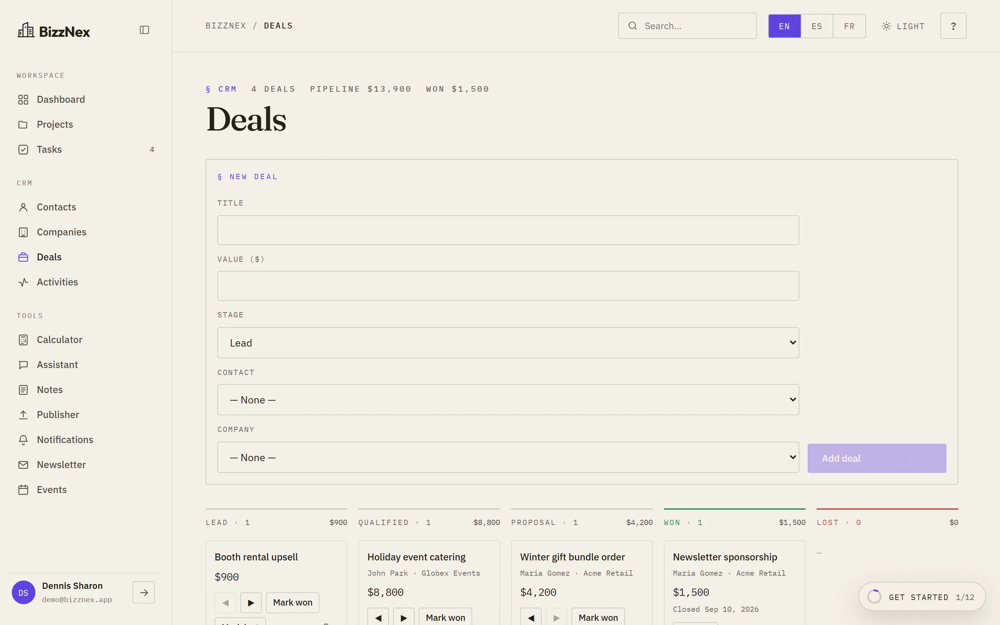 **Deals:** a stage pipeline; cards arc to their new column | 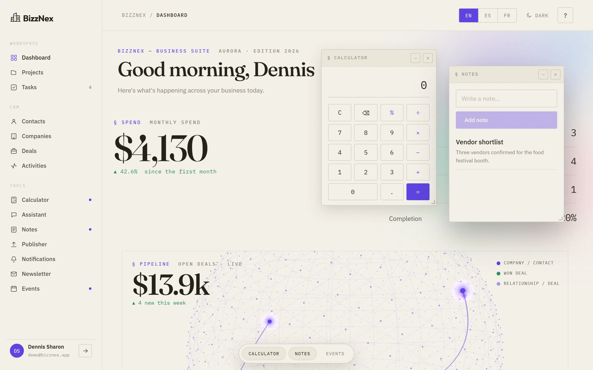 **Studio:** tools open beside your work, with a dock |
| 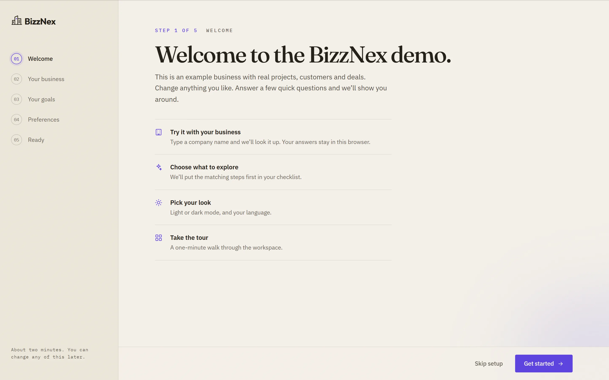 **Onboarding:** setup wizard, tour and checklist for new accounts | 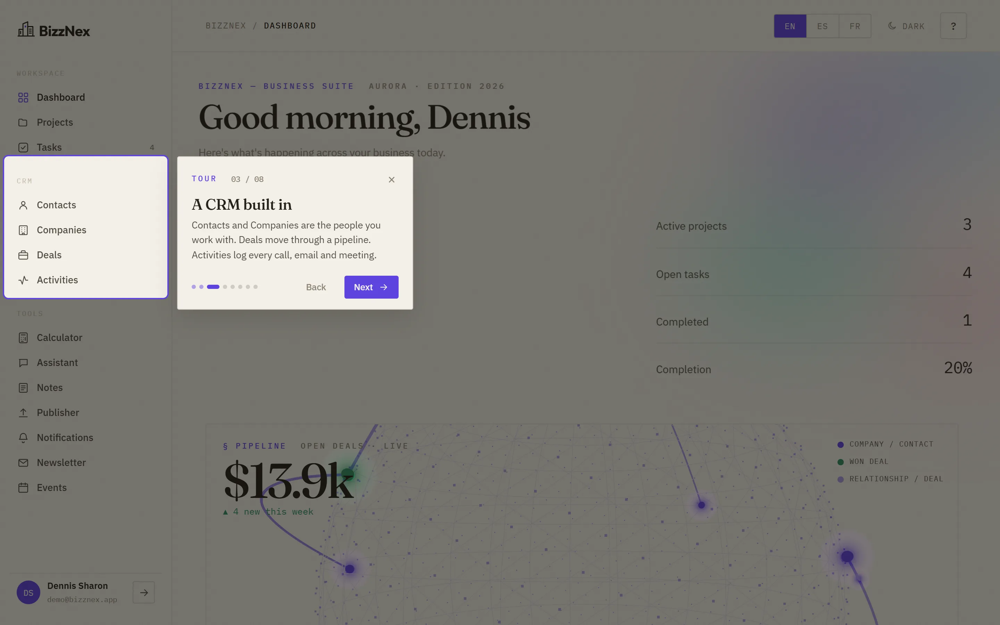 **Tour:** spotlights each area of the product |
| 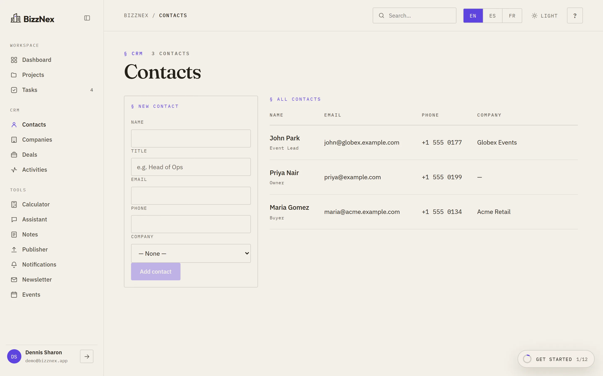 **CRM:** contacts, companies and an activity timeline | 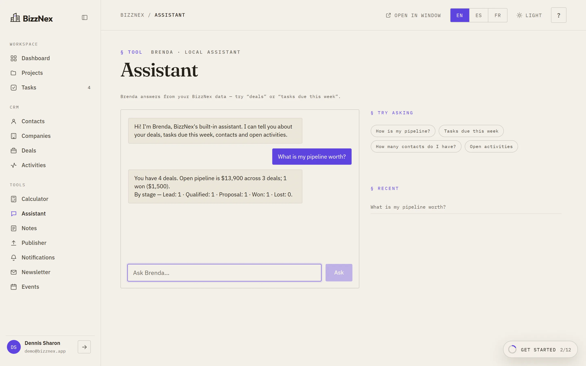 **Assistant:** answers from your own data, no API key |
| 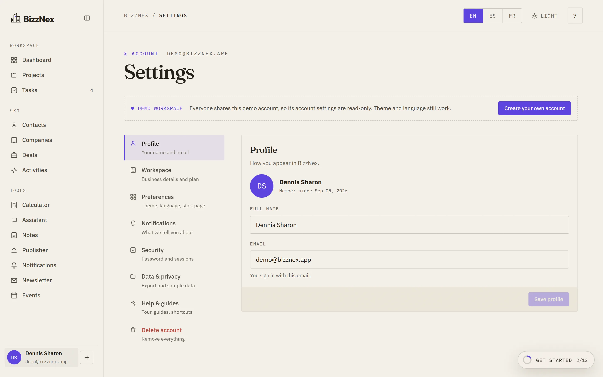 **Settings:** profile, security, data export, account deletion | 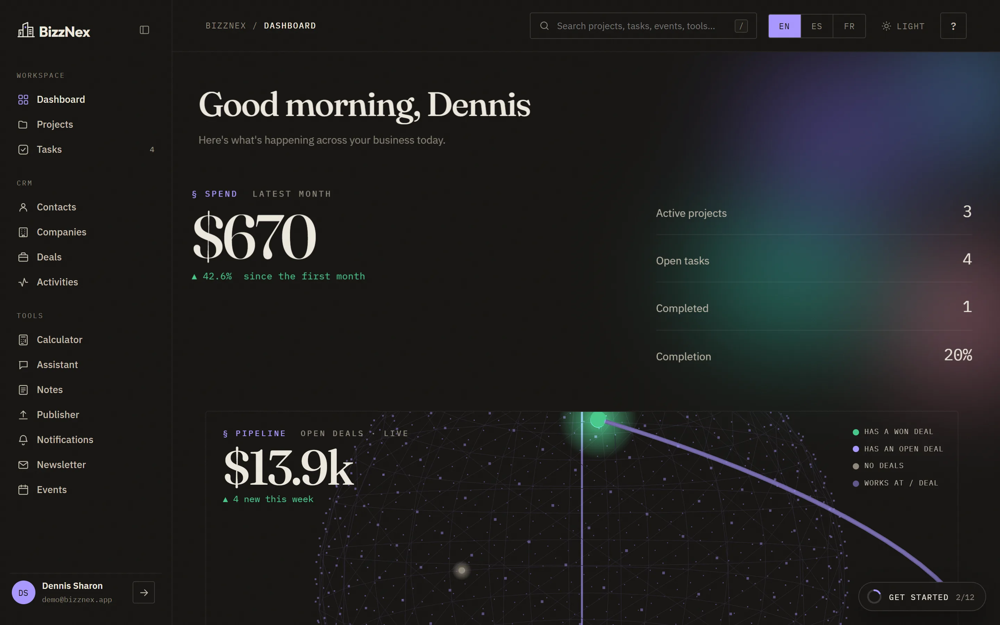 **Dark mode:** spreads from the switch |
| 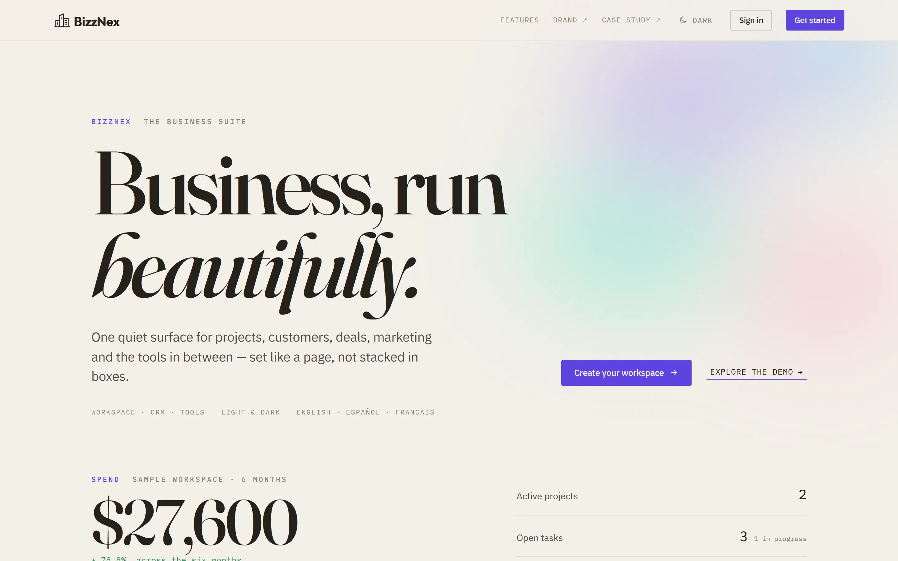 **Landing:** the signed-out home | 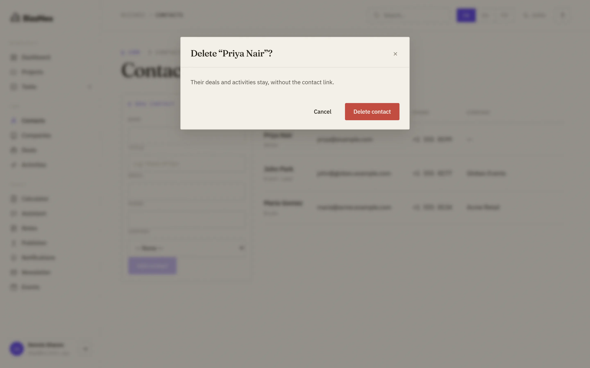 **Safe deletes:** every delete says what goes with it |

### What's worth a look (product engineering)
- **Tenant isolation that covers links:** you can't read, edit or *attach* another
  account's records, and e2e tests prove it ([§ 5](#5--architecture--engineering-decisions)).
- **Sessions you can revoke:** a password change signs every other session out.
- **A shared demo that can't be wrecked:** it resets itself on a timer, in one transaction.
- **Onboarding that respects returning users:** guided for new accounts and demo visitors,
  hands-off for sign-ins, with a `?` menu for everyone.
- **Failure states designed in:** load errors with Retry, optimistic moves that roll back,
  locked buttons while saving, readable API errors.
- **Motion with a purpose:** things move to and from where they belong, and reduced
  motion turns it all off.
- **Shipping discipline:** migrations, CI with Postgres-backed e2e tests, Docker images,
  and an honest list of what's simulated or not built ([§ 12](#12--honest-status)).

> **New developer?** Start with **[`ONBOARDING.md`](./ONBOARDING.md)** — setup, a guided
> first change, recipes, and troubleshooting. This README is the *what and why*;
> onboarding is the *how*.

> **Design artefacts:** canonical style guide → [`BizzNex-Style-Guide.html`](./BizzNex-Style-Guide.html) ·
> full design story → [`bizznex-case-study.html`](./bizznex-case-study.html) ·
> condensed write-up → [`CASE-STUDY.md`](./CASE-STUDY.md)

---

## Table of contents

1. [What it does](#1--what-it-does)
2. [The design story](#2--the-design-story)
3. [The Studio interaction model](#3--the-studio-interaction-model)
4. [The Aurora design system](#4--the-aurora-design-system)
5. [Architecture & engineering decisions](#5--architecture--engineering-decisions)
6. [Decision log](#6--decision-log)
7. [Tech stack](#7--tech-stack)
8. [Running it](#8--running-it)
9. [API surface](#9--api-surface)
10. [Testing & CI](#10--testing--ci)
11. [Deployment](#11--deployment)
12. [Honest status](#12--honest-status)
13. [Design artefact index](#13--design-artefact-index)

---

## 1 · What it does

### First run
- **Landing page** (`views/Landing.tsx`) — the product page every signed-out visit opens
  on, with *Create account*, *Sign in* and *Explore the demo*. Deep links
  `/?start=signup` and `/?start=signin` skip straight to the right tab.
- **Onboarding** (`apps/web/src/onboarding/`) — new accounts and demo visitors get a
  setup wizard (business, role, team size, goals), a spotlight product tour, a
  getting-started checklist driven by real actions, and a one-time intro card on each
  page. Returning sign-ins get none of that pushed at them, only the **?** help menu.
  Progress is stored on the account (`PATCH /onboarding`). See
  [`docs/onboarding-flow.md`](./docs/onboarding-flow.md).
- **Shared demo workspace** — one click signs in to a seeded account. The demo's account
  settings are locked server-side, and its data **resets itself** on the first demo
  sign-in after 30 minutes, so one visitor can't wreck it for the next.
- **Sample data** — any new account can load (and later remove) a realistic sample set
  in one transaction.

### Account settings
Click your name in the sidebar: **Profile** (name, email), **Workspace**, **Preferences**
(theme, language, start page), **Notifications**, **Security** (change password, which
signs every other session out), **Data & privacy** (JSON export of everything you own),
**Help & guides** and **Delete account** (type your email and password; every record
cascades).

Navigation is organised into three groups (`apps/web/src/nav.ts`):

### Workspace
- **Dashboard** — metrics computed live from real data (spend, active projects, open
  tasks, completion %), the monthly spend trend summed across projects, a projects table
  with inline sparklines, upcoming tasks, and the **Relationship Globe**. A new project
  starts with an empty spend history rather than an invented one.
- **Projects** — full CRUD, per-project progress, inline status, editorial modals.
- **Tasks** — every task across projects, grouped by status, one-click status cycling.

### CRM
- **Contacts** — CRUD, linked to companies.
- **Companies** — CRUD, with industry and website.
- **Deals** — a **stage pipeline board** (`Lead → Qualified → Proposal → Won → Lost`).
  Moving a deal to *Won* writes a real `Notification` row, unless the "Deal won"
  notification is turned off in Settings.
- **Activities** — calls, emails, meetings, notes and tasks against the CRM, with
  done/not-done state.

### Tools
**Calculator** (memory + history tape + business quick-calc) · **Assistant "Brenda"** ·
**Notes** (with in-page search) · **Publisher** (char-count + live preview) ·
**Notifications** (filters + feed) · **Newsletter** (send now or schedule for a chosen
time; the recipient count is your contacts with an email address) · **Events** (filters + table).

All seven persist to PostgreSQL. Every tool exists in **two variants** — a rich
full-page version and a compact window widget. See [§3](#3--the-studio-interaction-model).

### The Relationship Globe
A live three.js map of your CRM, lazy-loaded into the Dashboard
(`apps/web/src/views/Globe.tsx`). Nodes are companies and contacts, arcs are deals,
travelling pulses are recent activity, and won deals glow green. Every count comes from
real query data (`useGetContactsQuery` / `useGetCompaniesQuery` / `useGetDealsQuery`),
with no padding. An empty CRM shows an empty globe that tells you how to fill it.
Positions on the sphere are layout only. It recolours on theme change rather than
rebuilding the scene.

### Cross-cutting
- **Auth** — email/password, JWT, every row scoped per user. Sessions end when the
  password changes or the account is deleted.
- **Safe destructive actions** — every delete asks first and names what goes with it
  ("Its 4 tasks will be deleted too").
- **Failure states** — a list that fails to load says so, with *Retry*, instead of
  pretending to be empty. Save buttons lock while a request is in flight, and an expired
  session returns you to sign-in.
- **i18n** — English, Spanish, French (real translations, not English copies).
- **Theme** — light/dark via `data-theme`. The new theme spreads in a circle from the
  switch (View Transitions); browsers without them get a 500 ms cross-fade.
- **Motion** — the *Spatial* direction from [`design-style-guides/bizznex-motion.html`](./design-style-guides/bizznex-motion.html),
  in `apps/web/src/ui/motion.ts`. Pages slide the way you move through the sidebar
  (View Transitions API). Dialogs grow out of the button you pressed and shrink back
  into it. Studio windows grow from their control and shrink into the dock. Moved deals
  arc to their new column. Rows slide in and out (`@formkit/auto-animate`). Numbers count
  up and dark mode spreads from its switch. One token (`MOTION_SCALE` / `--m`, set to
  1.5) sets the pace.
- **Responsive**, and honours `prefers-reduced-motion`: with it on, every change is instant.

---

## 2 · The design story

### The problem being solved

The starting observation: most AI-assisted interfaces look alike. The cause isn't a
lack of taste, it's **distributional convergence** on Tailwind/shadcn defaults — and
the core habit of those defaults is **containerization**. Every element becomes a
bordered, shadowed, rounded card. The result reads as generated.

Aurora was built around the inverse rule:

> **Delete every border and the structure must still read.**

Grouping comes from whitespace (Gestalt proximity), a named-line grid, single hairline
rules, and asymmetric splits — not from boxes.

### Four visual iterations

| # | Direction | Introduced | Why it moved on |
|---|---|---|---|
| **v1** | Aurora (light, Apple-ish) | Refined periwinkle, one gradient, glassy rounded cards | Baseline; still flat |
| **v2** | Living | Breathing aurora background, Fraunces display serif, click-to-copy, dark toggle | Wanted more character |
| **v3** | Command Center | Dark-first, bento dashboard, Stripe-grade table, AI card, ⌘K palette | Researched Linear/Stripe/Vercel — still box-dominated |
| **v4** | **Editorial** ✅ | **Killed the boxes** — asymmetric grid, hairlines, warm paper, one accent, ledger table | **Adopted** |

### Three visual directions explored

| Direction | Verdict |
|---|---|
| **Aurora** — warm paper, editorial, one accent | ✅ **Adopted** |
| **Meridian** | ✕ Rejected |
| **Nocturne** | ✕ Rejected |

All three are preserved in `design-style-guides/` for comparison.

### North stars

Mercury, Linear, Attio, Stripe and Anthropic for data-dense-but-human product surfaces;
editorial studios **AREA 17** and **RoAndCo** for type and grid discipline.

### The 3D dashboard exploration

Eight separate prototypes were built and compared before anything shipped
(`design-style-guides/dashboard-3d/`): bars, orbs, globe, waves, rings, network, ribbon,
and globe-network. The **globe-network** hybrid won and became the Relationship Globe.

---

## 3 · The Studio interaction model

Four windowing paradigms were prototyped as full HTML mockups before implementation:

| Option | Model | Verdict |
|---|---|---|
| 1 · Hybrid | Inline pages + floating tools | Basis for the winner |
| 2 · Canvas | Free-floating infinite canvas | ✕ |
| 3 · Panels | Docked split panels | ✕ |
| **4 · Studio** | **Inline *and* windowed, chosen per interaction** | ✅ **Adopted** |

**Studio**, as shipped in `apps/web`:

- **Left-click a sidebar tool** → opens **full-page inline** in the main area. Each
  tool is a faithful React port of the mockup's rich page
  (`views/tools/registry.tsx` → `toolNode`).
- **Right-click a sidebar tool** → opens a **floating window** — draggable, resizable,
  minimizable — showing a **compact widget**, *not* the full page
  (`views/tools/widgets.tsx` → `toolWidget`, wired via `Sidebar.tsx`'s `onContextMenu`).
- Windows open at **280×380** (minimum 240×200) and **cascade** on a 6-slot rotation so
  a new window never lands exactly on the last one.
- A **dock** at bottom-centre lists open windows, and hides itself entirely when none
  are open.
- The topbar grows an **"Open in window ↗"** button while you're viewing a tool, and the
  sidebar shows a **dot** on any tool with a window already open.

**The lesson that shaped this.** The first implementation reused the *full-page*
component inside the small window. The giant serif title and mono spec-header ate the
frame — the calculator's keypad was pushed out of view and forms overflowed. That failure
is why the two-variant split exists: a window is **not** a smaller page, it's a different
component. Verified visually with Puppeteer screenshots driven from an isolated
scratchpad project, so the app's `node_modules` stayed clean.

Implementation: `layout/useWindows.ts` (open/close/focus/minimise, z-order, cascade),
`layout/ToolWindow.tsx` (drag + resize, geometry kept local so pointer-move never
re-renders the tree), `layout/WindowLayer.tsx`, `layout/Dock.tsx`.

---

## 4 · The Aurora design system

Source of truth: **`apps/web/src/styles/aurora.scss`** (about 530 lines). Both the style guide
and the case study mirror it.

### Palette — one accent, warm paper, no pure white

| Token | Light | Dark |
|---|---|---|
| `--paper` | `#F5F1E9` | `#141210` |
| `--ink` | `#211D16` | `#EDE8DD` |
| `--muted` | `#8B8474` | `#8E877A` |
| `--accent` | `#5B41E0` | `#A897FF` |
| `--rule` | `rgba(33,29,22,.18)` | `rgba(237,232,221,.16)` |
| `--ok` / `--warn` / `--bad` | `#2E8F60` / `#B67A16` / `#C24A3E` | `#46C98A` / `#E7B24E` / `#F0776B` |

Dark mode is **warm charcoal**, not blue-black. The original "aurora" gradient survives
only as a single soft mesh bloom (`--bloom-op` `.40` light / `.55` dark).

### Type — three faces, strict roles
- **Fraunces** (serif) — display and section titles only
- **IBM Plex Sans** — all UI text
- **IBM Plex Mono** — data, spec-labels, folio numbers, window chrome

Hierarchy is carried by **size and weight, never by tint**. Numeric data uses
`font-variant-numeric: tabular-nums lining-nums` so columns align.

### Space, shape, motion
- **Radius: one value, `3px`.** Rectangles stay near-sharp; only true marks (dots,
  avatars) go round.
- **Asymmetric spacing scale** — `6 · 12 · 20 · 34 · 56 · 92 · 140`. Deliberately not a
  doubling scale; the uneven jumps are what make the rhythm feel editorial.
- **Easing** — `--ease` (`cubic-bezier(.22, 1, .36, 1)`) for entrances and hover; the
  Spatial motion layer adds `--ease-sp` and `--spring` (`ui/motion.ts`). Static blocks
  never animate.
- **Paper grain** — a fixed SVG `feTurbulence` overlay at 5% opacity across the whole
  viewport.
- **Themed scrollbars** — 6px, accent-tinted via `color-mix`, in both engines.

### Signature details
Folio numbers, mono `§` spec-labels, hairline `.rule` dividers, and borderless ledger
tables. These are the elements that make a screenshot identifiably BizzNex.

---

## 5 · Architecture & engineering decisions

### Monorepo with one shared contract
npm workspaces: `apps/web`, `apps/api`, `packages/shared`.

`packages/shared/src/index.ts` is the **single source of truth** — TypeScript interfaces
*and* Zod schemas for every entity. The API validates with them, the web app types
against them. A field renamed there breaks both sides at compile time, which is the
entire point.

### API module pattern
Every resource module mirrors the same shape: `JwtAuthGuard` + `@CurrentUser()` +
`ZodValidationPipe`, with GET/POST/PATCH/DELETE. 16 controllers, all registered in
`app.module.ts` behind a global `ThrottlerGuard`. Errors funnel through one
`AllExceptionsFilter`.

### String enums, not Prisma enums
`Deal.stage` and `Activity.type` are `String` columns constrained by Zod in the shared
package, not Prisma `enum` types. Rationale: enum changes stay a code-level concern and
don't require a database migration, and the constraint lives in the same file the
frontend reads.

### Versioned migrations
`apps/api/prisma/migrations/` holds the schema history, starting from the `0_init`
baseline. The API container runs `prisma migrate deploy` on boot, which applies pending
migrations and never drops data. CI applies the same migrations to a fresh Postgres
before the e2e suite. An earlier version used `db push --accept-data-loss`, which was
fine for a demo and unacceptable for anything holding real data.

### Per-user isolation
All 11 content models cascade from `User`. Every query is scoped by `userId` from the
JWT; there is no "global" read path. Two things go beyond the obvious:

- **Links are checked too.** A deal can only point at *your* contact and company, and an
  activity only at *your* deal (`common/ownership.ts`). Without this, a valid id from
  another account could be attached to your record.
- **Tokens can be revoked.** The JWT carries the user's `tokenVersion`, and the strategy
  re-checks it (and that the user still exists) on every request. Changing the password
  bumps the version, which signs every other session out while the current one continues
  on a fresh token.

### Hardening
- `helmet` security headers, `X-Powered-By` removed, and a 256 kB JSON body limit.
- Rate limits: 300 requests a minute overall, and 10 a minute on sign-in, sign-up,
  password change and account deletion (`@nestjs/throttler`).
- CORS allows only configured origins. In production, a missing `CORS_ORIGIN` or
  `JWT_SECRET` stops the API from booting instead of falling back to something unsafe.
- Every string has a length limit and every amount is a bounded integer, validated in
  the shared Zod schemas.
- `AllExceptionsFilter` maps Prisma errors to proper statuses (P2002 → 409, P2003 → 400,
  P2025 → 404) and hides internals on a genuine 500.
- Publishing a post or sending a campaign is one request that creates the record in its
  final state, so a failure can't leave a stray draft behind.

### The assistant is local and key-free
**Brenda** (`apps/api/src/assistant/`) answers from *your own BizzNex data* — pipeline
value by stage, open tasks sorted by due date, contact and company counts, outstanding
activities — all via Prisma queries and intent matching.

**No external API. No API keys. No network calls.** An earlier version called a hosted
model and was removed by choice. An assistant that reports your real pipeline beats one
that needs a credit card to say hello.

### Honesty about what's simulated
`ui/PreviewBadge.tsx` marks the one thing this build cannot really do: **external
delivery** — actually sending an email, actually posting to a social platform. The
in-app data is real and persisted; only the outbound hop is simulated, and it says so on
the component rather than in a footnote.

### Frontend state
Redux Toolkit + **RTK Query** for all server state (cache, invalidation, loading and
error flags). Only genuinely local concerns — theme, language, active view, auth session
— live in hand-written slices (`uiSlice`, `authSlice`), persisted to `localStorage`.

### Dependencies deliberately dropped
The original app carried Fluent UI, MUI, framer-motion, styled-components and a
Google Maps dependency. All removed in favour of a hand-built Aurora component layer.
The UI primitives live in `apps/web/src/ui/`: `Icon`, `Logo`, `Modal`, `Toast`, `Confirm`,
`LoadError`, `CountUp` and `PreviewBadge`, plus `motion.ts` and `useThemeSwitch.ts`.
The production build splits React, state and i18n into long-lived vendor chunks
(about 83 kB gzipped for the app itself). The three.js globe is lazy-loaded into its own
chunk so it never blocks first paint.

---

## 6 · Decision log

| Decision | Chose | Why |
|---|---|---|
| Visual system | Container-less editorial (Aurora v4) | Boxes are *the* tell of generated UI |
| Accent colours | Exactly one | A rainbow of semantic colours reads as a template |
| Corner radius | `3px`, one value everywhere | Near-sharp is a stance; mixed radii are noise |
| Spacing scale | Asymmetric `6→140` | Even doubling scales feel mechanical |
| Dark mode | Warm charcoal | Blue-black fights the warm-paper identity |
| Windowing | Studio (inline **+** window) | Captures both "focus on one tool" and "glance while working" |
| Window content | Separate compact widgets | Shrinking the full page broke the layout — proven, not assumed |
| 3D dashboard | Globe-network, from 8 prototypes | Only one that stayed legible with real data volumes |
| Validation | Zod in `packages/shared` | One schema for API *and* client |
| Enums | String + Zod, not Prisma enums | Avoids a migration for a code-level change |
| Migrations | Versioned, `migrate deploy` on boot | `db push --accept-data-loss` was replaced once the app held real accounts |
| Shared demo | Self-resetting every 30 min | Locking it would hide the product; leaving it open lets one visitor break it |
| Session revocation | `tokenVersion` claim | Stateless JWTs, but a password change still ends other sessions |
| Deletes | Confirm dialog naming the side effects | One mis-click shouldn't remove a project and its tasks |
| Assistant | Local, no external API | No keys, no cost, no network — and it reads real data |
| Simulated features | Labelled in-product | Better than silently faking it |
| UI libraries | None | Aurora can't be expressed in someone else's primitives |
| State | RTK Query + 2 slices | Server state and UI state are different problems |
| Local DB | Embedded Postgres on `:5433` | Docker isn't required to run this |

---

## 7 · Tech stack

| Layer | Tech |
|---|---|
| **Web** | React 18.3, TypeScript 5.6, Vite 6, Redux Toolkit 2.4 + RTK Query, react-intl 7, Sass, three.js 0.160, @formkit/auto-animate |
| **API** | NestJS 10, Prisma 5.22, PostgreSQL, Passport JWT, bcryptjs, Zod, Swagger, helmet, @nestjs/throttler |
| **Shared** | TypeScript types + Zod schemas |
| **Infra** | Docker multi-stage, docker-compose, nginx, GitHub Actions, Railway |

**Data model (12 Prisma models):** `User` · `Project` · `Task` · `Note` · `Company` ·
`Contact` · `Deal` · `Activity` · `Campaign` · `Post` · `Event` · `Notification`

---

## 8 · Running it

> For the full walkthrough — prerequisites, a verification smoke test, your first
> guided change, and a troubleshooting table — see **[`ONBOARDING.md`](./ONBOARDING.md)**.

### Option A — Docker (everything, including Postgres)

```bash
docker compose up --build
# web → http://localhost:8080 · api → http://localhost:3001/docs
```

### Option B — Local dev, no Docker required

A self-contained PostgreSQL is bundled for local use — no Docker, no cloud, no install.

```bash
npm ci                                       # Node 20+ (see .nvmrc)

cp apps/api/.env.example apps/api/.env       # then set DATABASE_URL to port 5433 (see the file)
cp apps/web/.env.example apps/web/.env       # VITE_API_URL=http://localhost:3001

npm run db:local                             # keep running: Postgres on :5433
```

Then, in a second terminal:

```bash
npm run prisma:generate
npm run prisma:migrate                       # apply the migrations
npm run seed                                 # optional demo data
npm run dev                                  # api :3001 · web :3005
```

**Demo login:** `demo@bizznex.app` / `password`

> `scripts/local-db.mjs` keeps its data in `.pgdata/` (gitignored) and survives restarts.
> `embedded-postgres` is a regular dev dependency, so `npm ci` installs it.

### Root scripts

| Script | Does |
|---|---|
| `npm run dev` | build shared, then run api + web together |
| `npm run build` | build shared → api → web |
| `npm run typecheck` | type-check every workspace |
| `npm run lint` | lint every workspace (web, api, shared) |
| `npm run test` | unit tests (api + web) |
| `npm run seed` | reset the demo workspace |
| `npm run db:local` | embedded Postgres on :5433 |
| `npm run prisma:generate` / `prisma:migrate` | Prisma client / apply migrations |

---

## 9 · API surface

REST, JWT-protected except `auth` and `health`. Interactive Swagger UI at **`/docs`**.

```
POST   /auth/register · POST /auth/login · GET /auth/me

PATCH  /account/profile       → fresh token (the email is in it)
PATCH  /account/preferences · POST /account/password · DELETE /account
PATCH /onboarding · POST/DELETE /onboarding/sample   (state comes back on GET /auth/me)

GET    /projects · POST /projects · GET/PATCH/DELETE /projects/:id
GET    /tasks
POST   /projects/:projectId/tasks
PATCH  /projects/:projectId/tasks/:taskId
DELETE /projects/:projectId/tasks/:taskId

GET/POST /notes         · PATCH/DELETE /notes/:id
GET/POST /companies     · PATCH/DELETE /companies/:id
GET/POST /contacts      · PATCH/DELETE /contacts/:id
GET/POST /deals         · PATCH/DELETE /deals/:id
GET/POST /activities    · PATCH/DELETE /activities/:id
GET/POST /campaigns     · PATCH/DELETE /campaigns/:id
GET/POST /posts         · PATCH/DELETE /posts/:id
GET/POST /events        · PATCH/DELETE /events/:id
GET/POST /notifications · PATCH/DELETE /notifications/:id

POST   /assistant/ask
GET    /health          → { status, db, timestamp }
```

`/health` reports database reachability separately from process liveness, so a running
API with a dead DB is visible rather than silently green.

---

## 10 · Testing & CI

- **Unit** (34): Jest for the API (auth, account, ownership checks, error mapping,
  demo reset, projects) and Vitest for the web app (date handling, the calculator, error text).
- **E2E** (5): `apps/api/test/app.e2e-spec.ts` runs against a live PostgreSQL via
  supertest. It covers register → create → list, cross-account isolation (another
  user's records can't be read, edited, deleted or *linked*), and session revocation
  after a password change.
- **CI**: `.github/workflows/ci.yml` runs `npm ci`, applies the migrations to a
  Postgres 16 service, then typecheck → lint (all workspaces) → unit tests → build → e2e
  on every push and PR.

---

## 11 · Deployment

See **[DEPLOYMENT.md](./DEPLOYMENT.md)**. Primary target **Railway** (managed Postgres +
GitHub-driven deploys), with **Fly.io** and **Render** appendices. Three pieces: managed
Postgres, the API (`apps/api/Dockerfile`, multi-stage Node 20 Alpine), and the web app
(`apps/web/Dockerfile`, built then served by nginx with SPA fallback and immutable
asset caching).

`DEPLOYMENT.md` carries a **pre-deploy checklist**, including refreshing
`bizznex-case-study.html` — it's a living document that must be re-diffed against the
shipped tokens, components and tool inventory before each production deploy.

---

## 12 · Honest status

**Working and verified:** typecheck and lint clean in all three workspaces, 34 unit
tests, 5 e2e tests against Postgres, a clean production build, and browser runs of the
onboarding, settings and CRUD flows (including dates in a US time zone).

**Simulated by necessity** (needs third-party credentials, labelled with `PreviewBadge`
in-product): real email sending and real social posting. The in-app
records these create are real and persisted.

**Known limits:** lists aren't paginated yet. Deals and activities can't be edited
beyond their stage or done state, and posts and campaigns can't be edited after they're
created. Navigation, the dashboard, projects and tasks are translated into Spanish and
French; the CRM pages, tools, settings, landing, sign-in and onboarding are English-only. The demo reset runs in-process, which is right for
a single API instance but would need a scheduled job behind a load balancer.

**Not yet built** — the honest gap to full CRM/ERP parity: quotes and invoices, reporting,
teams and roles, CSV import, and the ERP modules (finance, inventory, orders, HR).

---

## 13 · Design artefact index

| File | What it is |
|---|---|
| [`BizzNex-Style-Guide.html`](./BizzNex-Style-Guide.html) | **Canonical** interactive style guide — *Aurora, Edition 2026*. Theme toggle, click-to-copy swatches. |
| [`bizznex-case-study.html`](./bizznex-case-study.html) | Full design case study — thesis, three directions, v1→v4 history, token reference, component gallery, windowing paradigms, decision log. Renders itself in Aurora. **Living document.** |
| [`CASE-STUDY.md`](./CASE-STUDY.md) | Condensed markdown write-up |
| `design-style-guides/index.html` | Index of the visual direction options |
| `design-style-guides/option-1-aurora.html` | **Aurora ✅** (identical to the root style guide) |
| `design-style-guides/option-2-meridian.html` | Meridian ✕ |
| `design-style-guides/option-3-nocturne.html` | Nocturne ✕ |
| `design-style-guides/windows-option-1-hybrid.html` | Hybrid — basis for Studio |
| `design-style-guides/windows-option-2-canvas.html` | Canvas ✕ |
| `design-style-guides/windows-option-3-panels.html` | Panels ✕ |
| `design-style-guides/windows-option-4-studio.html` | **Studio ✅** — the shipped model |
| `design-style-guides/dashboard-3d/` | 8 dashboard-3D prototypes → globe-network adopted |
| `design-style-guides/bizznex-identity-skyline.html` | **Skyline ✅** — the adopted logo and identity (served at `/brand/skyline.html`) |
| `design-style-guides/bizznex-identity.html` · `bizznex-logo-options.html` | Earlier identity and logo explorations |
| `design-style-guides/bizznex-motion.html` | Motion study — Quiet, Editorial, **Spatial ✅** (adopted at ×1.5) |
| `design-style-guides/archive/` | Dated snapshot of the earlier case study |
| `docs/onboarding-flow.md` | Step-by-step map of signup, demo and sign-in onboarding |
| `docs/screenshots/` | The screenshots in this README, taken from the demo workspace |

---

## Repository layout

```
bizznex/
├── apps/
│   ├── web/              # React 18 + Vite + RTK Query + react-intl
│   │   └── src/
│   │       ├── layout/   # Sidebar · Topbar · ToolWindow · WindowLayer · Dock · useWindows
│   │       ├── ui/       # primitives (Modal, Toast, Confirm, LoadError, CountUp…) · motion.ts
│   │       ├── onboarding/ # wizard · tour · checklist · page intros · help menu · guides
│   │       ├── views/    # Dashboard · Projects · Tasks · Contacts · Companies · Deals · Activities · Globe · Landing · Auth · Settings
│   │       │   └── tools/  # 7 tools — registry.tsx (pages) + widgets.tsx (compact)
│   │       ├── styles/   # aurora.scss — the design system
│   │       ├── store/    # authSlice · uiSlice
│   │       ├── services/ # RTK Query client (api.ts) · errors.ts
│   │       └── i18n/     # en · es · fr
│   └── api/              # NestJS + Prisma + PostgreSQL, JWT
│       ├── src/          # 13 resource modules + auth, users, prisma, health, assistant, demo, common
│       └── prisma/       # schema.prisma (12 models) · migrations/0_init · seed.ts → src/demo
├── packages/shared/      # types + Zod schemas — one contract, both sides
├── design-style-guides/  # every explored direction, preserved
├── scripts/local-db.mjs  # embedded Postgres, no Docker needed
├── docker-compose.yml · DEPLOYMENT.md · .github/workflows/ci.yml
```

---

## License

[MIT](./LICENSE)
