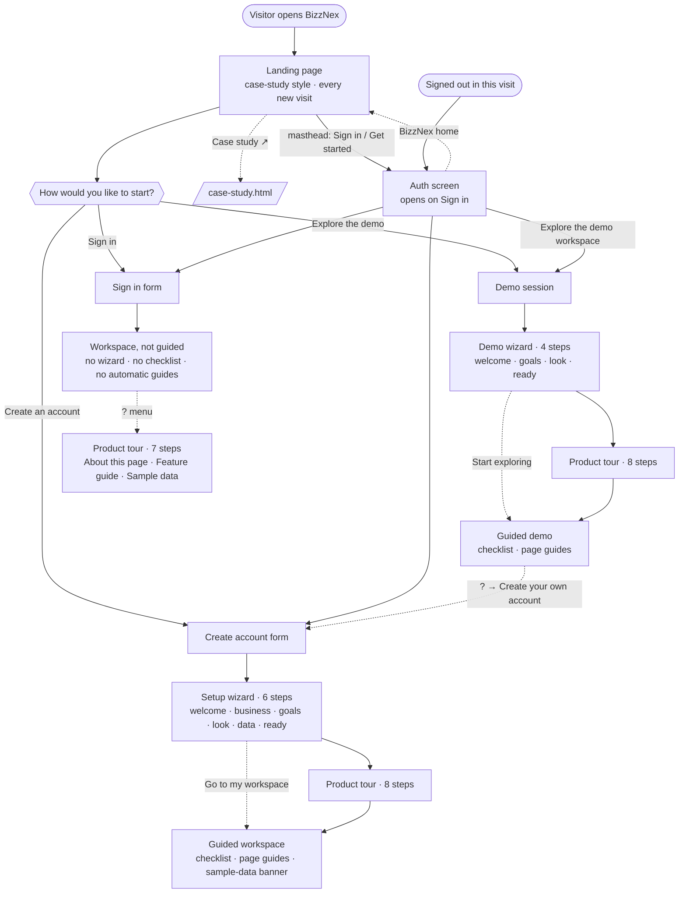

# Onboarding flow

How a person moves from first visit to working in BizzNex, and which onboarding they get.

**Rule of thumb:** new accounts and demo visitors are *guided*. People who sign in to an existing account are not. They only get what they open themselves from the **?** Help menu.

## Step by step

### 1. Signed out

| Step | Screen | What happens |
|---|---|---|
| 1 | **Landing page** (`views/Landing.tsx`, every new visit) | A product page in the Aurora style (not a case study): hero, sample-workspace stats and chart, Features, an insight band, Windows, How it works, Get started. Masthead: **Features** · **Windows** · **Getting started** · **Case study ↗** · **Sign in** · **Get started**. Hero: **Create your workspace** · **Explore the demo**. **Case study ↗** opens the full document at `/case-study.html`. |
| 2 | **Get started · How would you like to start?** | The last landing section: Create an account · Explore the demo · Sign in. |
| 3 | **Auth screen** | Tabs: Create account / Sign in. Field validation, a password strength meter, show/hide, a Caps Lock warning. **Explore the demo workspace** button. **BizzNex home** returns to the landing. |

Each new visit opens on the landing page. After a sign-out in the same visit, the app opens on the **Sign in** tab instead.

**Deep link:** `/?start=signup` (or `?start=signin`) skips the landing and opens that tab directly; the parameter is removed from the address bar once read, and a signed-in user just lands in their workspace. The case study's **Open BizzNex** and **Open the app** links use `?start=signup`.

### 2a. New account (Create account)

| Step | What the user sees |
|---|---|
| 1 | **Setup wizard, 6 steps:** Welcome → Your business (company, role, team size) → Your goals → Preferences (theme, language, applied immediately) → Your data (sample data or an empty workspace) → Ready |
| 2 | **Product tour, 8 steps** (or "Go to my workspace" lands on the page that fits their first goal) |
| 3 | **Getting-started checklist** (12 steps, goal-matched steps first, ticks off from real records; sample data doesn't count) |
| 4 | **First-visit page guide** on each of the 14 pages, dismissed once per page |
| 5 | **Sample-data banner** while sample records exist, with one-click removal |

Progress is saved **on the account**, so it carries across devices.

### 2b. Demo (Explore the demo)

Same as a new account, minus the steps that don't apply to a shared example business:

| Step | What the user sees |
|---|---|
| 1 | **Demo wizard, 4 steps:** Welcome to the demo → Your goals → Preferences → Ready |
| 2 | **Product tour, 8 steps** |
| 3 | **Checklist.** Only counts records created during this visit (the demo already has data). |
| 4 | **First-visit page guides** |
| 5 | **? → Create your own account** leaves the demo and opens sign-up |

Progress is kept **in this browser**, never on the demo account, so every visitor gets a fresh demo onboarding and nobody's progress affects anyone else's. Signing in with the demo credentials through the form also counts as a demo session. No sample-data options are shown in the demo.

### 2c. Returning user (Sign in)

No wizard, no checklist, no automatic page guides: they land straight in their workspace. The **?** menu (or the `?` key) offers:

| Item | Purpose |
|---|---|
| Product tour | 7 steps (the checklist step is left out) |
| About this page | The page guide for the current page, on demand |
| Feature guide | Every page in BizzNex, grouped like the sidebar, with jump links |
| Add / Remove sample data | Fill the workspace with an example business, or remove it again |

## Help (?) menu by session

| Item | New account | Demo | Sign in |
|---|:-:|:-:|:-:|
| Product tour | ✓ (8) | ✓ (8) | ✓ (7) |
| About this page | ✓ | ✓ | ✓ |
| Feature guide | ✓ | ✓ | ✓ |
| Brand & logo (Skyline + explorations + case study) | ✓ | ✓ | ✓ |
| Getting-started checklist | ✓ | ✓ | — |
| Run setup again | ✓ | ✓ | — |
| Add / Remove sample data | ✓ | — | ✓ |
| Create your own account | — | ✓ | — |

## Where things live

| Concern | Location |
|---|---|
| Session type (`signup` / `demo` / `signin`) | `auth.session` in `apps/web/src/store/authSlice.ts`, set at login |
| Past the landing / auth tab | `ui.introSeen` (reset on every load), `ui.authMode` in `apps/web/src/store/uiSlice.ts` |
| New-account progress | `User.onboarding` (database), via `PATCH /onboarding` |
| Demo progress | `auth.demoOnboarding` (browser storage) |
| Who is guided | `useOnboarding()` in `apps/web/src/onboarding/useOnboarding.ts` |
| All onboarding copy | `apps/web/src/onboarding/content.ts` |
| Landing page | `apps/web/src/views/Landing.tsx` + `styles/landing.scss` |
| Full case study | `bizznex-case-study.html` (repo root), served at `/case-study.html` by `apps/web/vite.config.ts` |
